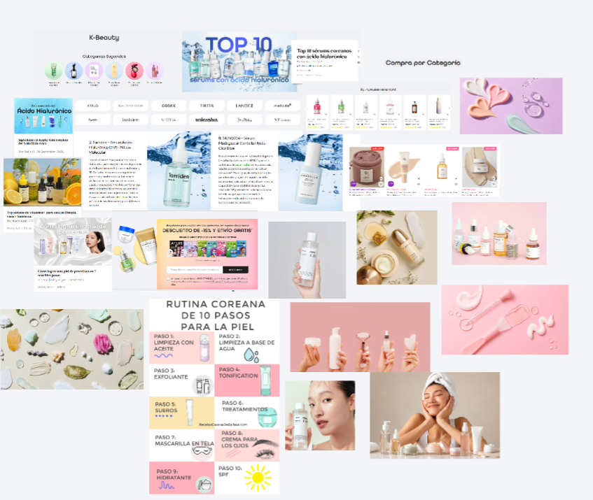

# Moodboard — Nabi Skin 

> Guía: [Moodboard](../evaluacion/guias/fase-2-specs/02-moodboard.md)

**Tablero en Whimsical:** https://whimsical.com/ana-s-cruz/3TUFs4HkuQbDqQg5absRRr

<!-- Captura: guárdala en docs/img/ y enlázala así:  -->

## Palabras clave

Luminosidad · Glass Skin · Natural · Fluidez · Calma

## Qué sensación buscamos

Queremos que Nabi Skin se sienta como un ritual de autocuidado fresco, limpio y reconfortante: mucha luz natural, tonos pastel suaves, texturas acuosas y un toque botánico simple. Sofía quiere una piel sana, luminosa y libre de irritaciones, pero le frustra no entender rutinas complicadas ni ingredientes difíciles; un estilo visual limpio, con fotos reales de pieles hidratadas y productos en texturas ligeras, le transmite confianza y le demuestra que cuidar su piel es un proceso sencillo y accesible.

<!-- 3 a 5 líneas: qué sensación y por qué conecta con tu proto-persona. -->
