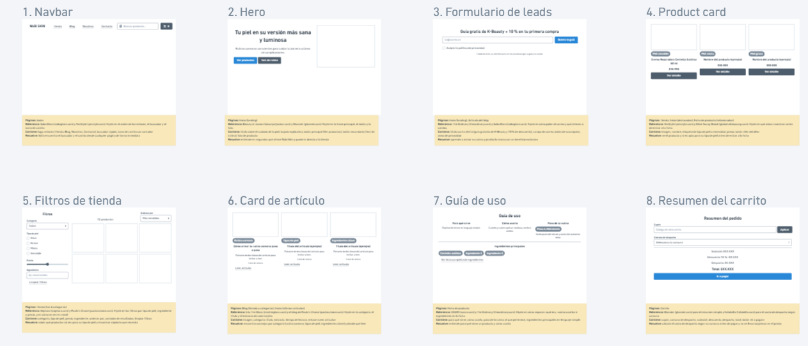

# Componentes — Nabi Skin 

> Guía: [Componentes](../evaluacion/guias/fase-2-specs/03-calco-de-componentes.md)

**Tablero en Whimsical:** https://whimsical.com/ana-s-cruz/nabi-skin-componentes-3V4D2Jdn5s9eX3jpfJy7mV

<!-- Mínimo 6 componentes que cubran landing, blog y tienda. -->

| Componente | Referencia | Qué contiene | Qué necesidad resuelve |
| Navbar | Sitio de K-Beauty A | Logo de Nabi Skin, enlaces (Tienda, Blog, Nosotros, Contacto), buscador rápido, ícono de carrito con contador | Sofía encuentra el buscador y el carrito desde cualquier página de forma inmediata |
| Hero | Sitio de cosmética B | Título sobre cuidado de la piel, bajada explicativa, botón principal ("Ver productos"), foto de producto | Entiende en segundos qué ofrece Nabi Skin y puede ir directo a la tienda |
| Formulario de leads | Sitio de e-commerce C | Título con la oferta (guía gratuita de K-Beauty y 10% de descuento), campo de correo, botón de suscripción | Aprende a armar su rutina y prueba la marca con un beneficio exclusivo |
| Product card | Sitio de K-Beauty D | Imagen, nombre, etiqueta de tipo de piel o necesidad, precio, botón "Ver detalle" | Ve el producto y si es apto para su tipo de piel antes de entrar a la ficha |
| Filtros de tienda | Sitio de cosmética E | Chips de categoría y lista desplegable de tipo de piel (sensible, grasa, mixta, seca) | Encuentra rápido los productos específicos que sirven para su tipo de rostro |
| Card de artículo | Blog de skincare F | Imagen, categoría, título del artículo, tiempo de lectura | Elige qué guía o consejo leer según sus dudas sobre luminosidad o textura |
| Guía de uso | Sitio de K-Beauty G | Pasos de la rutina coreana, ingredientes principales y explicación en lenguaje simple | Entiende exactamente para qué sirve un producto y cómo usarlo sin enredarse con términos técnicos |
| Resumen del carrito | Sitio de e-commerce H | Listado de productos, calculadora de despacho por comuna, importe total y botón de pago | Calcula el costo de envío según su comuna para no llevarse sorpresas en el precio final |
