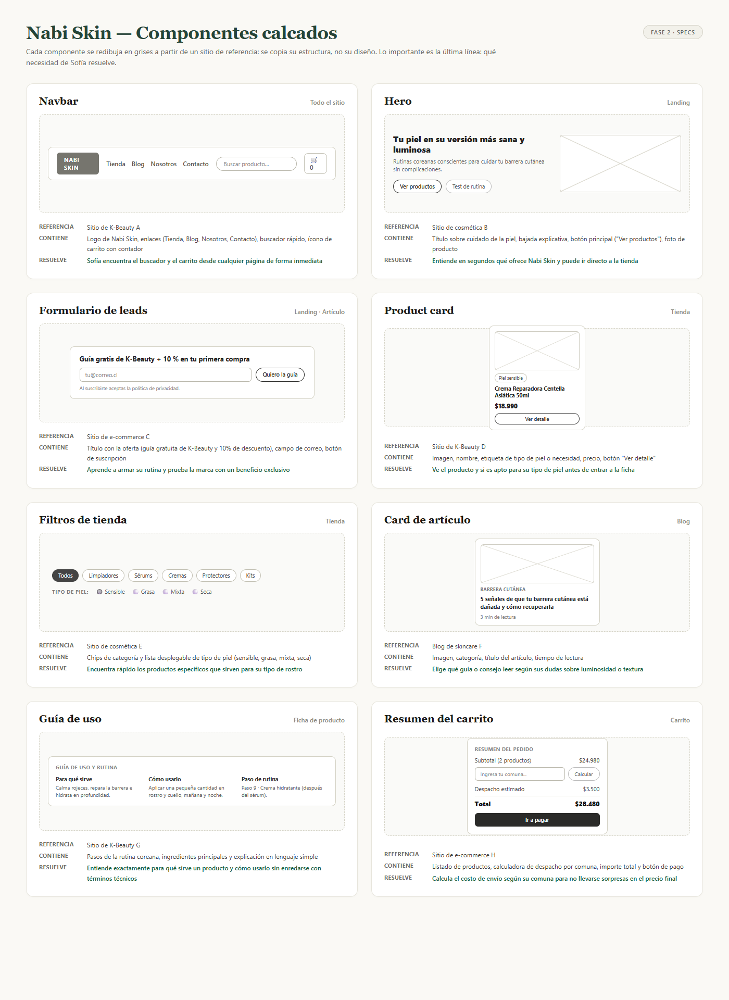

# Spec de diseño — Nabi Skin 

> Guía: [Spec de diseño](../evaluacion/guias/fase-2-specs/06-spec-de-diseno.md)

La spec de diseño tiene dos partes:

1. **[`DESIGN.md`](../DESIGN.md)** (en la raíz): tu design system, en el formato que Stitch importa.
2. **Este documento:** tus pantallas, escritas como prompts listos para pegar en Stitch.

**Wireframes en Whimsical:** https://whimsical.com/ana-s-cruz/wireframes-21ZxxPeyru25xYvSDAT25L

> Guía de wireframes: [Wireframes](../evaluacion/guias/fase-2-specs/04-wireframes.md)



## Pantallas

### 1. Landing

```text
Pantalla: Landing de Nabi Skin, versión desktop. Usa el design system del proyecto.
Objetivo: Que Sofía (24 años, piel sensible) entienda en segundos la propuesta de cosmética coreana consciente, sienta confianza y pueda ir directo a comprar o descargar la guía gratuita con 10% de descuento.
Componentes, de arriba hacia abajo:
1. Navbar: Fondo surface (#FFFFFF), logo "Nabi Skin" con tipografía serif, enlaces de navegación ("Tienda", "Blog", "Nosotros", "Contacto"), buscador rápido con input-field ("Buscar productos o ingredientes..."), e ícono de carrito con contador badge "0".
2. Hero: Layout de 2 columnas sobre fondo neutral (#FAF8F5).
   - Columna izquierda: Titular en headline-display "Tu piel en su versión más sana y luminosa", bajada en body-lg "Rutinas de cosmética coreana conscientes y respetuosas para cuidar tu barrera cutánea sin complicaciones.", y grupo de botones con button-primary ("Ver productos") y button-secondary ("Test de rutina").
   - Columna derecha: Fotografía editorial luminosa de piel hidratada (efecto glass skin) y envases cosméticos botánicos minimalistas.
3. Propuesta de valor: Fila de 3 tarjetas sobre fondo surface con rounded.lg y padding md:
   - "Renovación real y respetuosa": Fórmulas coreanas limpias para fortalecer la barrera cutánea.
   - "Metamorfosis guiada": Asesoría honesta según las necesidades exactas de tu piel.
   - "Autocuidado consciente": Rituales diarios simples para disfrutar el proceso de ver florecer tu piel.
4. Sección de productos destacados: Encabezado en headline-lg "Favoritos para empezar tu rutina" con bajada en body-md "Fórmulas suaves pensadas para pieles sensibles y reactivas". Grilla de 3 columnas de card-product:
   - Card 1: Imagen cuadrada, tag-routine "Piel sensible", nombre en title-md "Crema Reparadora Centella Asiática 50ml", precio "$18.990", button-secondary "Ver detalle".
   - Card 2: Imagen cuadrada, tag-offer "10% OFF", nombre en title-md "Sérum Iluminador Niacinamida + Vit C 30ml", precio "$16.190" (precio regular $17.990 tachado), button-secondary "Ver detalle".
   - Card 3: Imagen cuadrada, tag-routine "Rutina básica", nombre en title-md "Kit Limpieza y Cuidado Facial Coreano", precio "$32.990", button-secondary "Ver detalle".
5. Formulario de captación de leads (Lead magnet): Contenedor centrado sobre fondo secondary (#F4EAE2) con rounded.lg y padding 2xl.
   - Título en headline-md "Guía gratis de K-Beauty para principiantes + 10% en tu primera compra".
   - Bajada en body-md "Aprende el orden correcto de tu rutina y los ingredientes clave para tu tipo de rostro.".
   - Formulario en fila con input-field (placeholder "tu@correo.cl") y button-primary ("Quiero la guía").
   - Texto legal al pie en body-sm "Al suscribirte aceptas nuestra política de privacidad.".
6. Sección de comunidad y testimonios: 3 tarjetas con reseñas de clientas verificadas, valoración de 5 estrellas y texto de alivio en piel reactiva.
7. Footer: Fondo surface con enlaces a políticas, términos, botón a WhatsApp e Instagram oficial de Nabi Skin.
```

---

### 2. Tienda

```text
Pantalla: Tienda de Nabi Skin, versión desktop. Usa el design system del proyecto.
Objetivo: Que Sofía encuentre rápidamente cosmética coreana apta para piel sensible sin abrumarse con catálogos complejos ni términos confusos.
Componentes, de arriba hacia abajo:
1. Navbar: Con estado activo en "Tienda" e input-field de búsqueda visible.
2. Encabezado de catálogo: Título en headline-lg "Tienda K-Beauty", bajada en body-md "Cosmética coreana seleccionada para fortalecer tu barrera cutánea y potenciar tu luminosidad natural.", con buscador expandido input-field ("Buscar por nombre, ingrediente o síntoma...").
3. Barra horizontal de chips de categoría: Fila de chip-filter interactivos:
   - chip-filter-active ("Todos")
   - chip-filter ("Limpiadores")
   - chip-filter ("Tónicos y Esencias")
   - chip-filter ("Sérums")
   - chip-filter ("Hidratantes")
   - chip-filter ("Protectores solares")
   - chip-filter ("Kits de rutina")
4. Cuerpo principal en 2 columnas:
   - Columna izquierda (Filtros laterales, 280px): Tarjeta con fondo surface, borde sutil #E2DFD6 y padding md:
     * Grupo "Tipo de piel": Checkboxes con "Piel sensible (marcado)", "Piel mixta", "Piel grasa", "Piel seca".
     * Grupo "Necesidad o síntoma": Checkboxes con "Rojeces e irritación", "Manchas y opacidad", "Poros y textura", "Deshidratación".
     * Grupo "Precio": Barra de rango de $5.000 a $45.000.
     * Botón secundario button-secondary ("Limpiar filtros").
   - Columna derecha (Catálogo): Encabezado superior "Mostrando 9 productos para Piel sensible" con selector "Ordenar por: Más populares ▾". Grilla de 3 columnas con 6 card-product:
     * Card 1: Crema Reparadora Centella Asiática 50ml — $18.990 con tag-routine "Piel sensible".
     * Card 2: Limpiador Acuoso en Espuma pH 5.5 150ml — $13.990 con tag-routine "Limpieza suave".
     * Card 3: Aceite Limpiador Desmaquillante 200ml — $17.490 con tag-routine "Doble limpieza".
     * Card 4: Sérum Calmante de Centella & Pantenol 30ml — $19.990 con tag-routine "Anti-rojez".
     * Card 5: Kit Rutina Básica Piel Sensible (3 pasos) — $38.990 con tag-offer "Ahorra $4.500".
     * Card 6: Protector Solar Acuoso SPF 50+ PA++++ 50ml — $16.990 con tag-routine "Toque ligero".
5. Banner inferior de asesoría: Bloque con fondo secondary, texto "¿Tienes dudas sobre qué necesita tu piel?" y botón button-secondary ("Consultar por WhatsApp").
6. Footer.
```

---

### 3. Ficha de producto

```text
Pantalla: Ficha de producto de Nabi Skin, versión desktop. Usa el design system del proyecto.
Objetivo: Que Sofía entienda exactamente para qué sirve el producto, cómo y cuándo usarlo en su rutina coreana, y agregue al carrito con total seguridad.
Componentes, de arriba hacia abajo:
1. Navbar: Con acceso directo a navegación y carrito.
2. Miga de pan (Breadcrumbs): Texto en body-sm "Inicio > Tienda > Hidratantes > Crema Reparadora Centella Asiática".
3. Bloque principal de producto en 2 columnas:
   - Columna izquierda (Galería): Fotografía principal grande 1:1 en alta definición mostrando textura ligera de la crema y envase, más 3 miniaturas inferiores (textura en piel, envase y lista de ingredientes).
   - Columna derecha (Información y compra):
     * Badges superiores: tag-routine ("Piel sensible / Reactiva") y tag-routine ("Barrera cutánea").
     * Nombre en headline-lg "Crema Reparadora Centella Asiática 50ml".
     * Valoración: 5 estrellas con texto body-sm "4.9 · (38 reseñas de clientas)".
     * Precio en headline-md "$18.990".
     * Selector de formato en chips: "50 ml (seleccionado)" y "80 ml tamaño ahorro ($24.990)".
     * Selector de cantidad numérica (- 1 +) y botón ancho button-primary ("Agregar al carrito").
     * Enlace de consulta rápida con ícono de WhatsApp: button-secondary ("¿Dudas con este producto? Consultar por WhatsApp").
     * Aviso de despacho: Ícono de camión con body-sm "Despacho a todo Chile · Envíos en 24 a 48 hrs hábiles en Santiago".
4. Guía didáctica guide-usage (Guía de uso y rutina): Contenedor estructurado en 3 columnas sobre fondo surface con borde #E2DFD6 y rounded.md:
   - Columna 1 ("Para qué sirve"): "Calma rojeces al instante, repara la barrera cutánea dañada y sella la hidratación profunda sin dejar sensación grasosa."
   - Columna 2 ("Cómo usarlo"): "Aplica una pequeña cantidad del tamaño de una moneda sobre rostro y cuello limpios, mañana y noche, con suaves toques."
   - Columna 3 ("Paso en la rutina coreana"): "Paso 9 de 10 · Crema hidratante (después del sérum y antes del protector solar en el día)."
5. Pestañas de detalle técnico: Pestaña activa "Ingredientes clave" (Centella Asiática 70%, Madecassoside, Ceramidas y Pantenol; sin alcohol ni fragancias añadidas), pestaña "Preguntas frecuentes" y pestaña "Reseñas".
6. Productos sugeridos: Fila "Completa tu rutina de calma" con 3 card-product (limpiador acuoso y protector solar).
7. Footer.
```

---

### 4. Carrito

```text
Pantalla: Carrito de compras de Nabi Skin, versión desktop. Usa el design system del proyecto.
Objetivo: Que Sofía revise su pedido con total transparencia, calcule su despacho ingresando su comuna sin sorpresas de precio y avance al pago con tranquilidad.
Componentes, de arriba hacia abajo:
1. Navbar: Con ícono de carrito activo ("🛒 2 productos").
2. Encabezado de página: Título en headline-lg "Tu carrito de compras" con indicador de pasos ("1. Carrito > 2. Despacho > 3. Pago").
3. Layout principal en 2 columnas (60% / 40%):
   - Columna izquierda (Lista de productos):
     * Encabezado de tabla con columnas Producto, Precio, Cantidad y Subtotal.
     * Fila Producto 1: Miniatura de imagen, título en title-md "Crema Reparadora Centella Asiática 50ml", variante "50 ml", selector (- 1 +), precio "$18.990" y botón eliminar.
     * Fila Producto 2: Miniatura de imagen, título en title-md "Limpiador Acuoso en Espuma pH 5.5 150ml", selector (- 1 +), precio "$13.990" y botón eliminar.
     * Barra de incentivo de envío gratis: Barra de progreso en color primary con texto body-sm: "¡Agrega $7.020 más y tu envío es GRATIS en Santiago!".
     * Enlace button-secondary ("← Continuar comprando").
   - Columna derecha (Resumen del pedido cart-summary): Tarjeta sobre fondo surface, borde #E2DFD6, rounded.lg y padding lg:
     * Título en title-md "Resumen del pedido".
     * Fila subtotal: "Subtotal (2 productos): $32.980".
     * Calculadora de despacho por comuna: Etiqueta "Calcular costo de envío", fila con input-field ("Ingresa tu comuna, ej: Providencia") y botón secundario button-secondary ("Calcular").
     * Resultado del cálculo: "Despacho a Providencia: $3.500 (24-48 hrs hábiles)".
     * Campo de cupón de descuento: input-field con código "NABI10" aplicado y mensaje message-success ("Descuento 10% aplicado: -$3.298").
     * Total en headline-md: "Total final: $33.182".
     * Botón principal ancho button-primary ("Ir a pagar").
     * Sellos de confianza al pie: Íconos de Webpay / Mercado Pago, garantía de devolución y compra 100% protegida.
4. Footer.
```

---

### 5. Blog

```text
Pantalla: Blog de Nabi Skin, versión desktop. Usa el design system del proyecto.
Objetivo: Que Sofía descubra guías y consejos claros sobre salud de la piel, desmitifique ingredientes y aprenda a cuidar su rostro sin lenguaje técnico abrumador.
Componentes, de arriba hacia abajo:
1. Navbar: Con estado activo en "Blog".
2. Encabezado de blog: Título en headline-lg "El diario de tu piel", bajada en body-md "Consejos honestos, guías paso a paso y ciencia simple para cuidar tu barrera cutánea.".
3. Selector de categorías del blog: Fila de chip-filter:
   - chip-filter-active ("Todos")
   - chip-filter ("Rutina Coreana")
   - chip-filter ("Soluciones para la piel")
   - chip-filter ("Ingredientes clave")
   - chip-filter ("Mitos y verdades")
4. Artículo destacado (Hero post): Tarjeta horizontal grande con fondo surface y rounded.lg. Imagen editorial a la izquierda; a la derecha, tag-routine "Rutina Coreana", titular en headline-md "Doble limpieza coreana: Guía paso a paso para limpiar tu rostro sin irritarlo", bajada en body-md, tiempo "5 min de lectura" y botón button-secondary ("Leer artículo").
5. Grilla de artículos en 3 columnas con 6 card-article:
   - Card 1: Imagen, tag "Barrera cutánea", título "5 señales de que tu barrera cutánea está dañada y cómo recuperarla", tiempo "3 min de lectura".
   - Card 2: Imagen, tag "Ingredientes clave", título "Niacinamida y Centella Asiática: para qué sirven y cómo transforman la textura de la piel", tiempo "4 min de lectura".
   - Card 3: Imagen, tag "Piel sensible", título "Cómo armar una rutina coreana minimalista de solo 3 pasos", tiempo "3 min de lectura".
   - Card 4: Imagen, tag "Protección solar", título "Protector solar químico vs físico: cuál elegir si tu piel se enrojece con todo", tiempo "4 min de lectura".
   - Card 5: Imagen, tag "Ingredientes clave", título "Ácido hialurónico: el error común que puede deshidratar tu piel", tiempo "3 min de lectura".
   - Card 6: Imagen, tag "Autocuidado", título "Glass Skin real: por qué una piel luminosa no significa una piel sin poros", tiempo "5 min de lectura".
6. Bloque de captación de newsletter / guía: Tarjeta centrada en fondo secondary con input-field y button-primary ("Quiero recibir consejos y 10% OFF").
7. Footer.
```

---

### 6. Artículo

```text
Pantalla: Artículo del blog de Nabi Skin, versión desktop. Usa el design system del proyecto.
Objetivo: Que Sofía resuelva una molestia puntual de su piel (tirantez/irritación), entienda sus causas y pueda comprar directamente el cosmético recomendado.
Componentes, de arriba hacia abajo:
1. Navbar: Con navegación visible.
2. Encabezado del artículo: Miga de pan ("Inicio > Blog > Soluciones para la piel"), tag-routine ("Soluciones para la piel"), título en headline-display "5 señales de que tu barrera cutánea está dañada y cómo recuperarla", metadatos con fecha "8 de octubre, 2026" y tiempo "3 min de lectura · Por Equipo Nabi Skin".
3. Fotografía principal destacada: Imagen horizontal 16:9 de alta resolución con rounded.lg que muestra piel en calma y texturas hidratantes.
4. Contenedor de lectura centrado (ancho máximo 760px):
   - Párrafo de introducción en body-lg: "¿Sientes que tus productos de siempre de pronto te arden o tu piel luce opaca y tirante? Tu barrera cutánea podría estar comprometida."
   - Subtítulo en headline-md "1. ¿Qué es la barrera cutánea y por qué se altera?" y texto explicativo en body-md.
   - Subtítulo en headline-md "2. Las 5 señales de alerta" (tirantez tras lavar, rojeces repentinas, ardor al aplicar crema, textura áspera y brotes inesperados).
   - Tarjeta destacada de producto recomendado: Bloque integrado con fondo secondary, rounded.md y padding md:
     * Imagen de producto, título en title-md "Recomendación: Crema Reparadora Centella Asiática 50ml".
     * Descripción breve: "Fórmula calmante con madecassoside y ceramidas vegetales que sella la humedad y repara la barrera desde la primera noche."
     * Precio "$18.990" y botón primario button-primary ("Ver producto recomendado").
   - Subtítulo en headline-md "3. Plan de acción SOS de 14 días" con pasos simples para recuperar la luminosidad.
   - Bloque de compartir: Botones button-secondary para "Compartir en WhatsApp" y "Compartir en Instagram".
5. Sección de comentarios y dudas: Formulario con campos "Nombre", "Correo", "Tu duda sobre tu piel" y botón button-secondary ("Enviar duda"), más 2 comentarios con respuesta de las asesoras de Nabi Skin.
6. Fila de artículos relacionados: 2 card-article ("Sigue leyendo sobre cuidado de la piel").
7. Footer.
```

---

### Versión mobile (para cada pantalla)

```text
Genera la versión mobile (375px de ancho) de esta pantalla siguiendo la sección Layout del design system:
- Margen lateral de 16px en todo el ancho de la pantalla.
- Navbar colapsada: logo centrado en Playfair Display, ícono de lupa para búsqueda emergente, ícono de carrito 🛒 con badge numérico y botón hamburguesa que despliega drawer lateral con los enlaces (Tienda, Blog, Nosotros, Contacto).
- Tipografía adaptada: titulares principales h1 reducidos a 32px (headline-lg) con interlineado 1.2; párrafos mantenidos en 16px (body-md) para legibilidad óptima en celular.
- Catálogo y tarjetas: las grillas de 3 y 4 columnas pasan a 1 sola columna vertical con tarjetas full-width (o grilla de 2 columnas compactas de 160px de ancho).
- Filtros de tienda: los filtros laterales se transforman en una barra sticky superior con botón "Filtrar por tipo de piel (1)" que abre un drawer modal deslizante desde abajo (bottom-sheet).
- Carrito de compras: layout vertical de 1 sola columna donde la lista de productos va arriba y la tarjeta de resumen 'cart-summary' con la calculadora de despacho por comuna se sitúa al final antes del botón 'button-primary' "Ir a pagar" (ancho completo).
- Touch-friendly: todos los botones e inputs conservan una altura mínima de 44px para facilitar la interacción táctil con el pulgar.
```
