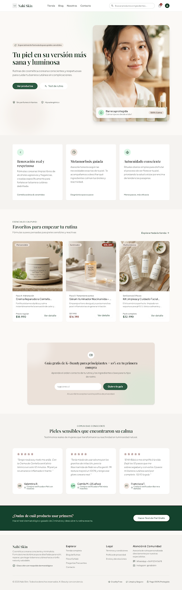
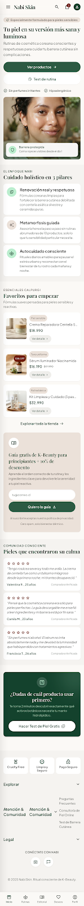
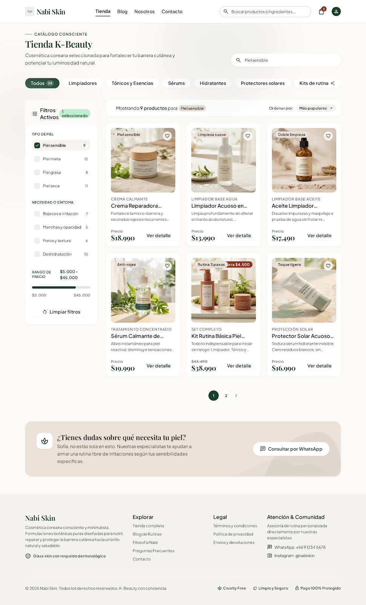
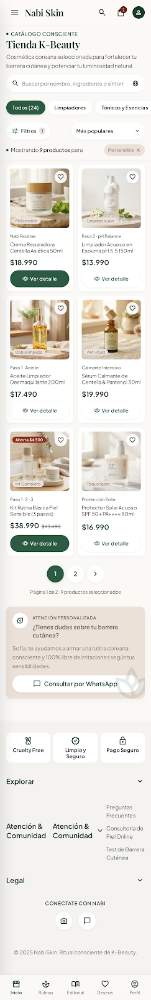
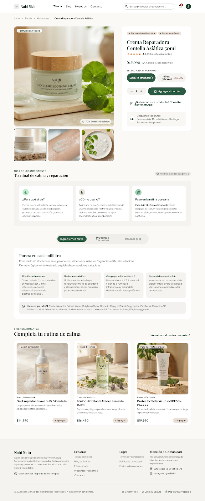
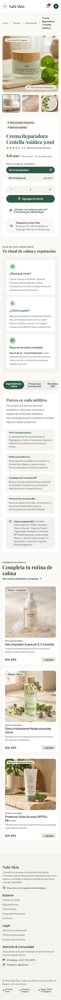
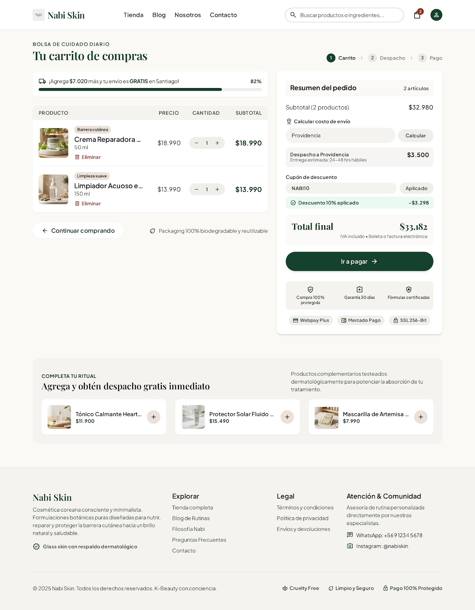
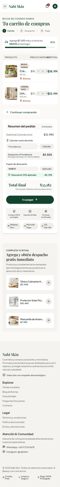
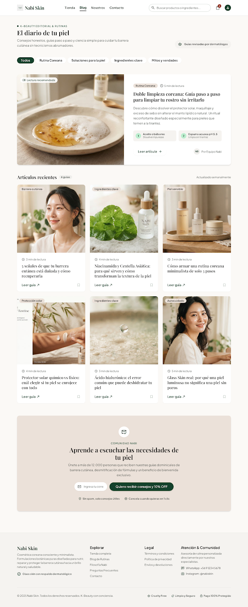
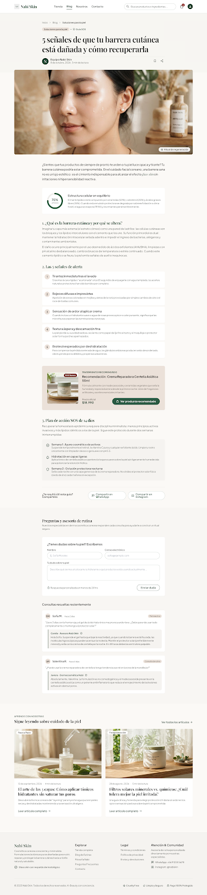

# QA y coherencia — Nabi Skin

> Guía: [QA y coherencia](../evaluacion/guias/fase-3-prototipo/02-qa-y-coherencia.md)

## Prototipo en Stitch

> Guía: [Prototipo en Stitch](../evaluacion/guias/fase-3-prototipo/01-prototipo-en-stitch.md)

**Proyecto:** https://stitch.withgoogle.com/projects/15130692259384807424

| Pantalla | Desktop | Mobile |
|---|---|---|
| Landing |  |  |
| Tienda |  |  |
| Ficha de producto |  |  |
| Carrito |  |  |
| Blog |  |  |
| Artículo |  |  |

---

## Revisión: spec vs. prototipo

| Pantalla | Qué dice la spec | Qué generó Stitch | Resultado | Corrección |
|---|---|---|---|---|
| **Landing** | Hero con botones "Ver productos" y "Test de rutina" | Generó ambos botones con los estilos `button-primary` y `button-secondary` | ✅ | — |
| **Landing** | Hero solo con titular, bajada, botones y foto editorial | Agregó claims inventados ("Hipoalergénico", "100% Calma", "Sin perfumes irritantes") | ❌ → ✅ | Se ajustó el prompt prohibiendo inventar certificaciones médicas o claims sin respaldo clínico |
| **Landing** | Sección de captación de leads con guía gratuita y 10% OFF | Generó la caja sobre fondo durazno (`secondary`), campo de correo y botón "Quiero la guía" | ✅ | — |
| **Landing** | Productos destacados con precios fijos ($18.990, $16.190 y $32.990) | Respetó los nombres y precios exactos definidos en la spec | ✅ | — |
| **Tienda** | Grilla de 6 productos con selector de categorías y filtro por tipo de piel | Generó la grilla y filtros, pero agregó íconos no pedidos (favoritos y cuenta de usuario) | ❌ → ✅ | Se agregó al prompt: "No agregues componentes, secciones ni elementos fuera de esta lista" |
| **Tienda** | Precio visible en todas las tarjetas de producto | Todas las tarjetas muestran su precio en negrita sin necesidad de interactuar | ✅ | — |
| **Tienda** | Banner inferior para asesoría personalizada | Generó bloque con botón para consultar vía WhatsApp | ✅ | — |
| **Ficha** | Bloque `guide-usage` en 3 columnas (para qué sirve, cómo usarlo, paso en rutina) | Creó las 3 columnas, pero indicó "Paso 4" mientras que en la spec se nombraba como "Paso 9" | ❌ → ✅ | Se unificó el catálogo único de productos especificando el paso exacto de la rutina coreana |
| **Ficha** | Selector de variantes (50 ml y 80 ml) y botón "Agregar al carrito" | Generó los chips de tamaño con sus precios correspondientes y el botón principal ancho | ✅ | — |
| **Ficha** | Botón secundario para consultar dudas por WhatsApp | Incluyó el botón directo para resolver consultas sobre ingredientes antes de comprar | ✅ | — |
| **Carrito** | Tabla con productos seleccionados y control de cantidad | Creó la lista con miniatura, nombre y selector numérico (- 1 +) | ✅ | — |
| **Carrito** | Calculadora de costo de despacho al ingresar la comuna | Mostró el campo con botón "Calcular" y el desglose de envío antes del total | ✅ | — |
| **Carrito (mobile)** | Resumen del pedido (`cart-summary`) apilado verticalmente debajo de la lista | Mantuvo la columna lateral apretada, provocando desborde visual en pantalla pequeña | ❌ | Stitch no logró apilarlo completamente en mobile; queda registrado como ajuste prioritario en CSS para la etapa de código |
| **Blog** | Categorías en chips ("Rutina Coreana", "Soluciones", "Ingredientes") | Generó los chips de filtrado interactivo coincidentes con la arquitectura de información | ✅ | — |
| **Blog** | Artículo destacado horizontal y grilla de 6 `card-article` | Generó la tarjeta hero y las 6 cards con título, tag y tiempo estimado de lectura | ✅ | — |
| **Artículo** | Tarjeta de producto recomendado integrada dentro del cuerpo de lectura | Stitch colocó el producto como un banner publicitario gigante al final del artículo | ❌ → ✅ | Se especificó en el prompt que la recomendación debía ser una card integrada entre los párrafos del texto |
| **Artículo** | Botones para compartir en WhatsApp e Instagram y caja de comentarios | Mostró los accesos para compartir y el formulario para dudas de clientas | ✅ | — |

---

## Mejoras a mis specs

A partir de las diferencias encontradas en la generación de Stitch, se aplicaron mejoras concretas a las especificaciones (siguiendo la metodología *spec-driven design*):

1. **Catálogo unificado de productos en `docs/09-spec-diseno.md`:** Se fijó un listado único con nombre oficial, formato, precio exacto, tag y paso de rutina para cada producto. Esto evitó que Stitch alterara nombres o precios entre la Tienda, la Ficha y el Carrito.
2. **Regla contra claims médicos en `DESIGN.md`:** Se incorporó en la sección *Do's and Don'ts* la prohibición estricta de inventar afirmaciones clínicas ("hipoalergénico", "dermatológicamente testeado") o cifras no verificadas ("12.000 personas"), manteniendo la promesa de honestidad y transparencia de Nabi Skin.
3. **Cierre de prompts con delimitación estricta en `docs/09-spec-diseno.md`:** Se agregó al final de cada prompt la instrucción *"No agregues componentes, secciones ni textos fuera de esta lista"* para evitar la aparición espontánea de íconos de favoritos o inicio de sesión.
4. **Regla de identidad de la proto-persona:** Se explicitó en los prompts que "Sofía" es el arquetipo de diseño para guiar las decisiones de interfaz, y que su nombre no debe ser utilizado como texto visible o usuario simulado en las pantallas.
5. **Alineación de categorías entre `docs/05-arquitectura.md` y `docs/09-spec-diseno.md`:** Se homologaron los nombres de las categorías del blog ("Rutina Coreana", "Soluciones para la piel", "Ingredientes clave") para garantizar consistencia total entre el mapa de sitio y la interfaz.

---

## User flows

| Flujo | Recorrido en el prototipo | ¿Se completa? |
|---|---|---|
| **Flujo 1: Compra** | Landing → Clic en botón del Hero [Ver productos] → Tienda → Filtro por necesidad [Piel sensible] → Clic en `card-product` [Ver detalle] → Ficha de producto (Crema Reparadora) → Selección de variante [50 ml] → Clic en [Agregar al carrito] → Carrito → Ingreso de comuna [Providencia] y clic en [Calcular] → Carrito listo para pagar con total transparente | ✅ |
| **Flujo 2: Contenido** | Blog → Clic en artículo [5 señales de que tu barrera cutánea está dañada] → Lectura de causas y síntomas → Clic en tarjeta integrada de recomendación [Ver producto recomendado] → Ficha de producto → Consulta opcional por WhatsApp o avance directo al carrito | ✅ |

---

## Coherencia

El objetivo central definido en el brief de **Nabi Skin** era vender cosmética coreana online a clientas de todo Chile, proyectando confianza, transparencia y delicadeza en el cuidado de la piel sensible. El prototipo en Stitch responde directamente a este propósito: permite recorrer el flujo de compra completo en solo 4 clics desde la landing page, con una estética luminosa y reconfortante inspirada en el concepto de *glass skin*.

Para resolver la principal frustración de nuestra proto-persona **Sofía** (el miedo a comprar productos costosos que le irriten el rostro o no entender rutinas saturadas de pasos), el prototipo incorpora filtros rápidos por tipo de piel y necesidad, y en cada ficha de producto incluye el componente didáctico `guide-usage`, que explica en lenguaje sencillo para qué sirve cada producto, cómo aplicarlo y en qué paso de la rutina va. Asimismo, su temor a cobros sorpresivos de despacho se solucionó integrando la calculadora por comuna directamente en el carrito de compras, antes de solicitar datos de pago.

**Lo que cambió respecto a la Fase 1:** Inicialmente se contempló una rutina coreana clásica de 10 pasos con una amplia variedad de productos; sin embargo, al validar la experiencia con las necesidades de Sofía, se priorizó un enfoque de **autocuidado minimalista** (rutina básica de 3 a 4 pasos: limpieza suave, hidratación reparadora y protección solar). Esto evitó sobrecargar la interfaz en dispositivos móviles, redujo la fricción de compra para principiantes y consolidó un sitio web mucho más claro, honesto y empático.
